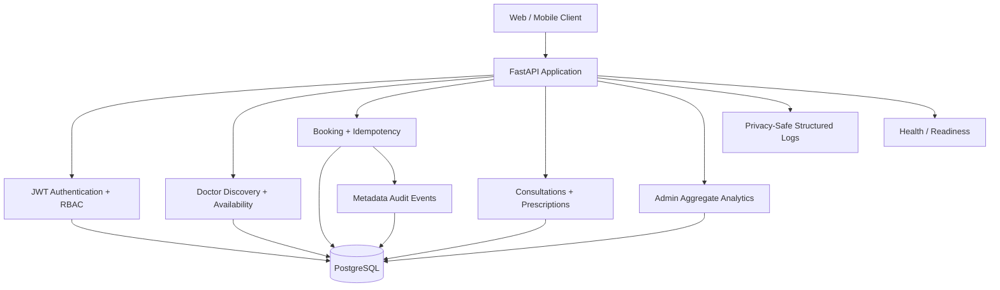
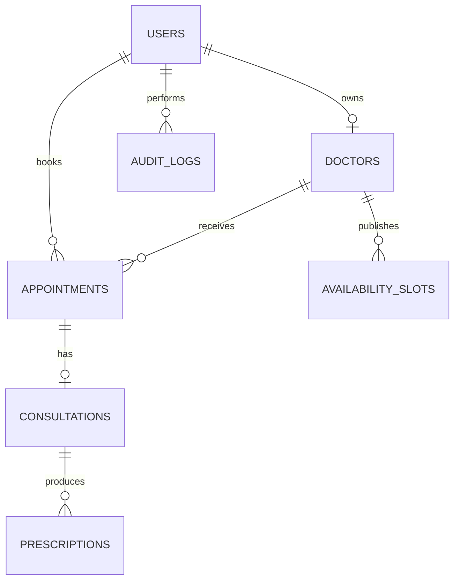
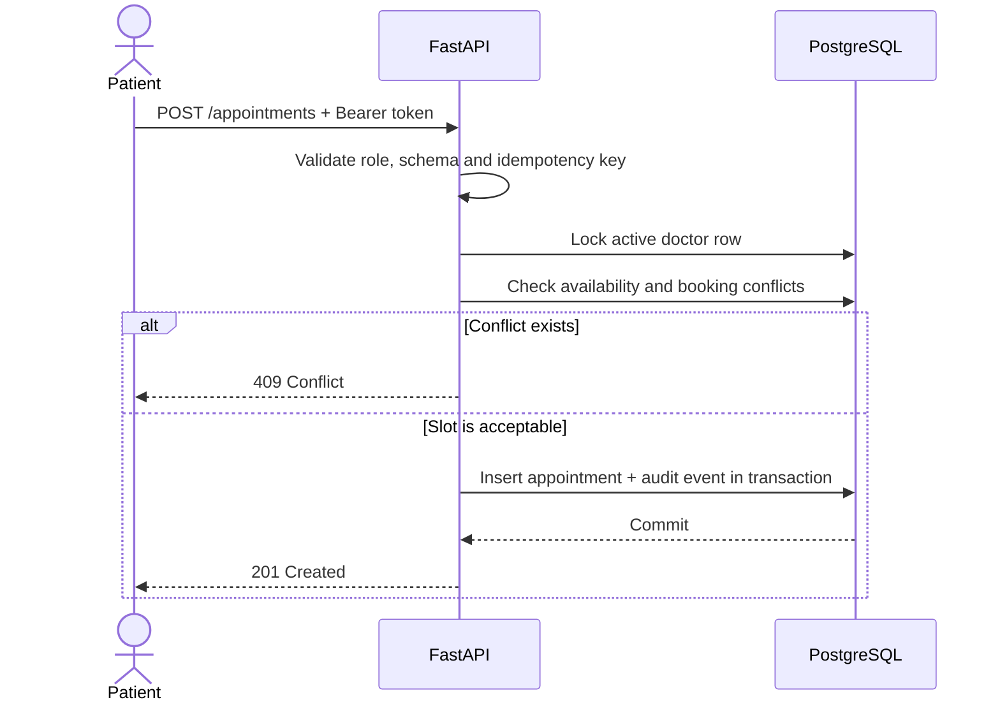

# Architecture and Security Boundaries

## Overview

Amrutam Healthcare API is a synchronous FastAPI service backed by SQLAlchemy and PostgreSQL. It uses Pydantic request/response schemas, JWT bearer access tokens, and Argon2 password hashes. API modules are separated by business domain rather than by HTTP method.

## Request path

1. FastAPI validates request bodies, path values, query parameters, and headers against app/schemas.
2. Protected routes resolve bearer tokens through get_current_user. The token identifies a user; authorization uses the current database record and role rather than trusting the role claim alone.
3. Routes query or mutate SQLAlchemy models through the get_db session dependency.
4. Routes return explicit Pydantic response models to avoid exposing password hashes or unapproved ORM fields.

## Main components

| Path | Responsibility |
| --- | --- |
| main.py | FastAPI app, router registration, liveness/readiness endpoints |
| app/api/routes/auth.py | Patient registration, login, token validation, current-user profile |
| app/api/routes/doctors.py | Public active-doctor discovery and admin-only doctor-profile creation |
| app/api/routes/appointments.py | Patient booking/cancellation and patient/assigned-doctor appointment access |
| app/api/routes/consultations.py | Assigned-doctor consultation lifecycle and notes |
| app/api/routes/prescriptions.py | Prescription creation and role-scoped retrieval |
| app/core/permissions.py | Administrator authorization dependency |
| app/core/security.py | Argon2 password hashing and verification |
| app/db/session.py | SQLAlchemy engine, sessions, and declarative metadata |
| app/models | Relational entities and constraints |
| app/schemas | Input normalization, validation, and response contracts |
| alembic/versions | Database schema history |
| tests | Isolated HTTP/API tests using an in-memory SQLite database |

## Data model

- **User** represents an account and its role: patient, doctor, or admin. Public registration always creates a patient.
- **Doctor** represents a discoverable provider profile. doctors.user_id links the profile to a doctor login; it is nullable for legacy/imported profiles and unique when populated.
- **Appointment** links a patient user to a doctor profile, stores a timezone-aware scheduled instant, and has a booked, cancelled, or completed status.
- **Consultation** is unique per appointment and stores notes, start time, and completion time.
- **Prescription** belongs to a consultation and stores clinician-authored medication details and instructions as text.

## Authorization matrix

| Operation | Patient | Assigned doctor | Admin |
| --- | --- | --- | --- |
| Register a public account | Yes; role fixed to patient | No special registration path | No special registration path |
| Discover active doctors | Yes | Yes | Yes |
| Create a doctor profile | No | No | Yes |
| Book/cancel an appointment | Own booking | No | No |
| Read appointment details | Own appointment | Assigned doctor only | Not enabled by default |
| Start/update/complete a consultation | No | Assigned doctor only | Not enabled by default |
| Create a prescription | No | Assigned doctor for that consultation | Not enabled by default |
| Read prescriptions | Own patient records | Records for assigned doctor profile | Not enabled by default |

For object-level authorization, routes scope database queries to the authenticated patient's ID or the active doctor profile linked to the authenticated doctor user. An inaccessible appointment/consultation is returned as not found where that avoids revealing the existence of another user's record.

## Workflow rules

1. Appointment input must include a timezone and be in the future. The API normalizes scheduled instants to UTC.
2. Booking rejects a missing/inactive doctor, an already-booked exact-time conflict, and patient exact-time conflicts. The optional Idempotency-Key makes a repeated identical request return the original appointment; reusing a key for a different request returns conflict.
3. A consultation can be started only by the active doctor account linked to the appointment's doctor profile, and only while the appointment is booked.
4. Consultation notes can be updated by the assigned doctor until completion. Completed notes are read-only because this implementation does not yet provide an audited amendment workflow.
5. Completing a consultation marks the consultation complete and the appointment completed in one database transaction.
6. A doctor can create a prescription only for a consultation associated with that doctor's profile. Patients only see their own prescriptions.

The current conflict logic matches exact appointment instants; appointment duration, provider availability windows, clinic calendars, and overlapping intervals are not modelled yet. Do not interpret exact-time conflict checks as a full scheduling engine.

## Health endpoints

- GET /health/live is a process liveness check and does not open a database connection.
- GET /health and GET /health/ready run SELECT 1 and return HTTP 503 when the database is unavailable. Use these for service readiness.
- Health responses intentionally do not include exception messages, credentials, hostnames, or connection strings.

## Database migration guidance

The first migration is a baseline marker for an existing schema and is intentionally a no-op for legacy databases. The subsequent migration links doctor profiles to user accounts. Follow the exact database initialization paths in the root README; do not stamp a revision blindly, and do not run fresh-database setup commands against a database containing production data.

The current repository does not automatically provision cloud infrastructure, apply migrations to a hosted database, or prove that a production database matches the ORM models. Those operations require environment-specific access and a verified backup/rollback plan.

## Security controls and known production considerations

Implemented controls include Argon2 password hashes, JWT expiration, startup validation for token configuration, no public role selection during registration, admin-only doctor-profile creation, role-scoped record queries, database uniqueness/foreign-key constraints, typed request/response schemas, and generic readiness errors.

Before production use, still configure TLS, secret management/rotation, database backups and restore drills, rate limiting for login/registration, audit logging for access to clinical records, retention policies, operational alerting, and a documented recovery process. Password-reset scripts are operator tools, not a public self-service password-reset flow. This project does not claim regulatory compliance or replace clinical governance.

## Test philosophy

Tests use an in-memory SQLite database and synthetic test accounts/data. They do not need production credentials and must not be pointed at a live database. CI checks dependency consistency, Python syntax compilation, and the automated suite on the configured Python matrix. SQLite integration tests verify API behavior but cannot fully simulate PostgreSQL locking, migration behavior, or production traffic; validate those separately in a disposable PostgreSQL environment before deployment.

## Supplemental design references

- Booking sequence: see [booking-sequence.mmd](booking-sequence.mmd).
- Security risks, controls and residual gaps: see [threat-model.md](threat-model.md).
- Metrics, structured logging, traces and alert proposals: see [observability.md](observability.md).
- Local deployment, release checklist, incident triage and recovery: see [operations-runbook.md](operations-runbook.md).

## Explicit assignment gaps

The assignment requests profiles, availability slots, payments, audit logs, admin analytics, full observability and infrastructure-as-code deployment. The current ORM/domain implementation does not yet include all of those workflows. The Render Blueprint and Docker Compose configuration are starter infrastructure definitions, not evidence of a deployed high-availability environment. The k6 script is a low-volume smoke test, not evidence that 100,000 daily consultations or the stated latency/availability SLOs have been achieved.

Before production claims are made, implement and test provider availability/interval-overlap constraints at the database level, an append-only clinical audit trail, admin analytics with authorization and aggregation rules, and the required payment workflow if in scope. Run concurrent booking tests on disposable PostgreSQL, measure p50/p95/p99 under representative load, configure a telemetry collector and alert delivery, and execute a database restore drill.

## Assignment traceability addendum

### Component architecture

### Core data model

### Booking sequence

### Concurrency and measured targets

Booking and availability writes lock the relevant doctor row with `SELECT ... FOR UPDATE` on PostgreSQL, then perform conflict checks inside the transaction. CI now provisions PostgreSQL and runs concurrency tests for simultaneous booking and overlapping availability creation. Passing CI is evidence for those test scenarios only; it does not prove all isolation, rescheduling, failover or production load cases.

The assignment targets (100,000 consultations/day, p95 reads under 200 ms, p95 writes under 500 ms and 99.95% availability) remain unverified targets. The k6 script is only a low-volume health/readiness smoke test. A representative workload, realistic data, capacity tests, fault injection and sustained monitoring are required before making performance or availability claims.

### Security boundary and known gaps

The app uses Argon2 password hashes, expiring JWTs, patient-only public registration, role-scoped access, metadata-only appointment audit events and privacy-safe route-template logs. Remaining production work includes privileged-user MFA, distributed rate limiting, complete clinical/authentication audit coverage, key rotation, retention policy, external metrics/traces/alerts and verified backup/restore drills. No regulatory compliance claim is made.
